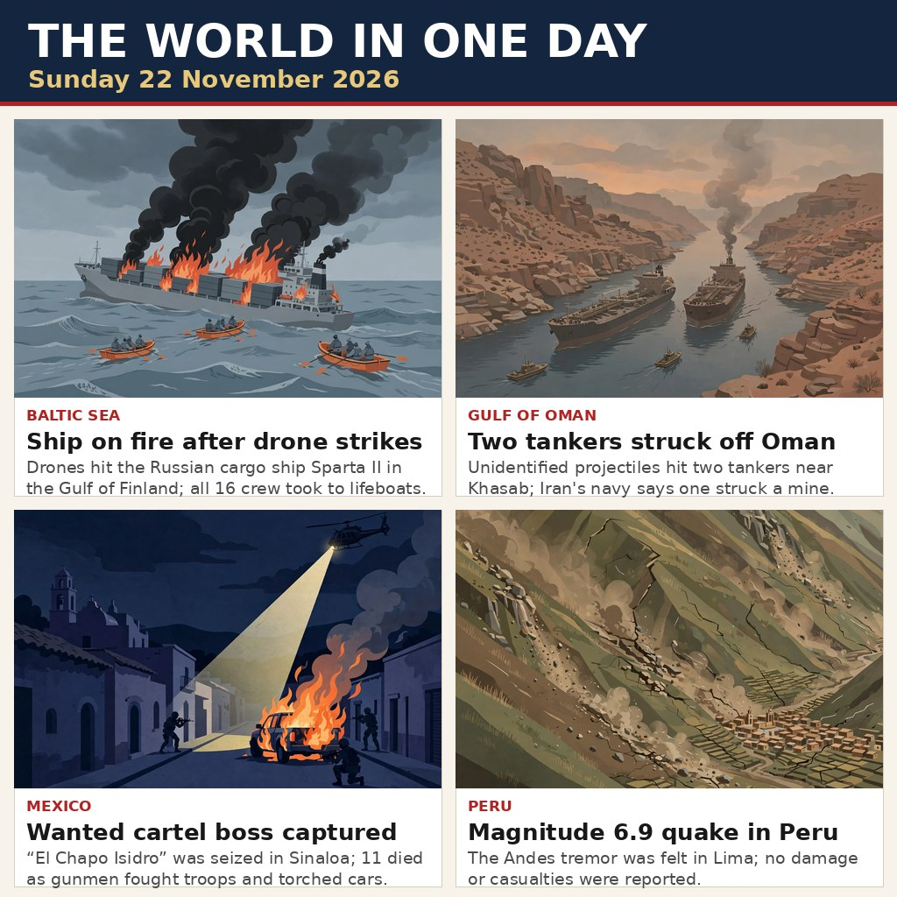

# The World in One Day — Sunday 22 November 2026

[](https://make.fun/bounty/news-image-20261122?utm_source=github&utm_medium=readme&utm_campaign=news-image-20261122)
[](https://make.fun/bounty/news-image-20261122/leaderboard?utm_source=github&utm_medium=readme&utm_campaign=news-image-20261122)
[](https://make.fun/bounty/news-image-20261122?utm_source=github&utm_medium=readme&utm_campaign=news-image-20261122)

A one-image summary of Sunday 22 November 2026, built for the make.fun bounty
[news-image-20261122](https://make.fun/bounty/news-image-20261122).



## The four stories

- **Ship on fire after drone strikes.** The Russian cargo ship Sparta II, bound for Kaliningrad, was hit by two drones on Saturday in the Gulf of Finland, caught fire and drifted into Finnish waters; all 16 crew were evacuated to lifeboats and the fire was still burning on Sunday. Finland says Ukraine was likely behind it, and Prime Minister Petteri Orpo said "the war is spilling over". Sources: Reuters, CNN, NY Post, 21–22 November 2026.
- **Two tankers struck off Oman.** Two tankers were struck by unidentified projectiles on Saturday near Khasab, Oman — one at the rear about 20 km north of Khasab, one in the engine room about 31 km east — and Iran's navy says a tanker caught fire after hitting a naval mine. Shipping through the Strait of Hormuz is under fire. Source: UKMTO via Al Jazeera, 21 November 2026.
- **Wanted cartel boss captured.** FBI Ten Most Wanted cartel boss Fausto Isidro Meza-Flores, "El Chapo Isidro", was captured on Friday night in Guasave, Sinaloa; 11 people were killed — 4 soldiers and 7 gunmen — as gunmen battled troops and torched vehicles, and he was flown to Mexico City on Saturday. Sources: AP, CNN, 21 November 2026.
- **Magnitude 6.9 quake in Peru.** A magnitude 6.9 earthquake shook the Andes in central Peru, with its epicentre 34 km north of Junín at a depth of 108 km; tremors were felt in Lima, and no damage or casualties were reported. Sources: USGS via AP/Reuters, 20 November evening local time / 21 November 00:09 UTC.

## How the image was made

Four scene illustrations were generated fresh for this entry in a flat editorial style, with no text inside them, then composited into the 1024×1024 front page with Python's Pillow library: a navy masthead names the day, and a 2×2 grid gives each story its picture, a short headline and one line carrying the key fact. Every letter in the finished image was drawn by the compositing script, so the text is crisp and nothing is garbled. The finished image is 1024×1024 pixels, saved as a JPEG of 241,723 bytes — well under the 1 MiB limit.

## Why these four?

They are the four most consequential stories in the 22 November news cycle, and they span regions and fields rather than one country or one beat: European security (a Russian ship burning in the Baltic), Gulf shipping (tankers struck off Oman), Latin American crime and justice (a most-wanted cartel boss captured in Mexico), and a natural disaster (a major quake in the Peruvian Andes). Each one carries a checkable fact — a crew of 16, two tankers, 11 killed, magnitude 6.9 — and each was verified against a live reputable source on the day.

## Running it

```sh
mkdir -p out && MAKEFUN_OUTPUT_DIR=out node main.ts
```

This copies the shipped `entry.png` to `out/entry.png`. It uses only the Node standard library, needs no network, and is deterministic — running it twice produces byte-identical output.

Built for make.fun — try it yourself: https://make.fun/r/1e3qpbvy
